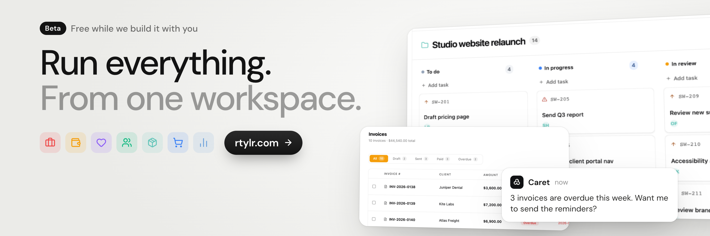

# rtylr

**Run everything. From one workspace.**

One workspace to run a small business — work, finance, customers, team,
operations and sales, with **Caret**, the AI built in.

> **Beta · Free while we build it with you.**

[**Start free →**](https://portal.rtylr.com/register) · [Website](https://rtylr.com) · [Docs](https://docs.rtylr.com) · [Self-host](#self-hosting)



## What's inside

| Module | What it does |
| --- | --- |
| **Flow** | Projects, tasks, roadmaps, cycles, team workload |
| **CRM** | Customers, loyalty tiers, campaigns, segments |
| **Finance** | Invoices, expenses, P&L, tax, reconciliation |
| **ERP** | Inventory, suppliers, purchasing, stock |
| **HR** | Staff, shifts, payroll, time off, reviews |
| **POS** | Point-of-sale terminal, Vite web app + Tauri desktop shell |
| **Menu** | Public customer menu with QR codes, served from the Portal origin |
| **Insights** | Cross-app analytics, revenue, operations, reports |
| **Recruit** | Careers sites and an HR submissions inbox |
| **Caret** | The built-in AI: asks about overdue invoices, drafts, and answers across modules |

Each app is standalone. A business can buy one module and use it without ever
touching the others — there is no all-or-nothing switch.

## Quick start

Requires pnpm 10.33 (pinned in `clients/package.json`), Node 20.19+ or 22.12+
(Vite 7's floor), and Go 1.27+ if you want the backend.

```sh
git clone https://github.com/rtylrs/rtylr.git
cd rtylr

pnpm -C clients install --frozen-lockfile
make -C voxie generate              # contracts are generated, not committed
git config core.hooksPath .githooks # committed hooks; git does not track this

pnpm -C clients --filter @rtylr/portal dev
```

The Portal comes up on `http://localhost:5175`. The landing site runs with
`pnpm -C clients/web/landing dev` on port 4200.

Typecheck everything, or one member:

```sh
pnpm -C clients -r typecheck
pnpm -C clients --filter @rtylr/portal typecheck
```

## Layout

| Path | What it is |
| --- | --- |
| `clients/` | The pnpm workspace root. Everything JavaScript/TypeScript. |
| `clients/app/` | The Portal application: business modules, the public customer menu, plus separate SSO and public Recruit entrypoints. |
| `clients/web/landing/` | Marketing site, Next.js static export. |
| `clients/web/docs/` | Documentation site, Next.js static export. |
| `clients/mcp/` | The MCP server — gives AI agents access to Flow, CRM, Finance, ERP. |
| `clients/pos/` | POS terminal: Vite web app plus the Tauri desktop shell in `core/`. |
| `clients/packages/` | Shared `@voxire/*` library layer and the generated contracts package. |
| `voxie/` | API contracts (`.onk`) plus generated Go and OpenAPI output. In-tree, single source of truth. |
| `services/onion/` | The Go backend: modules, platform packages, sqlc, worker. |

`rtylrs/infra` and `rtylrs/pipelines` stay separate — infrastructure and the
reusable build-and-deploy workflows.

## One workspace

Everything under `clients/` is a member of the pnpm workspace rooted at
`clients/`, with a single lockfile. Apps depend on the shared layer through
`workspace:*`.

This is deliberate. Separate installs for the same packages gave a linked
package one copy of its dependencies per consumer, and type identity needs the
same declaration files, not the same versions.

## Architecture

**Stack:** React 19, Vite 7, Next.js 15 (landing and docs), TypeScript 5.9 in
strict mode, Tailwind CSS, TanStack Query v5, Zustand, neverthrow, motion.
Backend is Go with MySQL, sqlc, and Protocol Buffer contracts.

### Contract-first

API request and response types are Protocol Buffers in `voxie/proto`, shared
between frontend and backend as the single source of truth.

```
voxie/proto/
  common/v1/   # pagination, errors, timestamps
  auth/v1/     # login, register, password reset
  hub/v1/      # team, business, apps, dashboard, billing, developer
```

Change a `.onk` file, regenerate, and every consumer moves with it in one
commit. Generated TypeScript is committed.

### Errors as values

Every API call returns a `Result` instead of throwing:

```ts
import { createApiClient, safeFetch, unwrap } from '@voxire/api';

const api = createApiClient('crm');
const safe = safeFetch(api);

export function useProducts() {
  return useQuery({
    queryKey: ['products'],
    queryFn: () => unwrap(storeApi.listProducts()),
  });
}
```

`safeFetch` returns `ResultAsync<T, ApiError>`; `unwrap()` bridges into React
Query. Network failures, validation errors and auth errors are values you match
on, not exceptions that escape a component.

### Per-app structure

```
apps/{name}/src/
  features/{feature}/    # screen component + co-located hook
  shared/                # components, lib, services, hooks, stores
  layouts/DefaultLayout.tsx
  routes/AppRoutes.tsx
```

## GitHub Copilot / AI agents

`clients/mcp` ships an MCP server so an assistant can read and write your
workspace — tasks, invoices, customers, inventory:

```sh
npx @rtylr/mcp
```

See [`clients/mcp/README.md`](clients/mcp/README.md) for Claude Desktop and
other client configuration.

## Self-hosting

Run rtylr on your own infrastructure with Helm or Docker Compose. Self-hosting
is free — you pay only if you want support or managed hosting.

```sh
git clone https://github.com/rtylrs/rtylr-self-host.git
cd rtylr-self-host

helm upgrade --install rtylr ./helm/rtylr \
  --set-string secrets.jwtSecret=$(openssl rand -hex 32) \
  --set ingress.domain=example.com
```

Or Docker Compose: `docker compose --env-file .env up -d`.

Installers live in [`rtylrs/rtylr-self-host`](https://github.com/rtylrs/rtylr-self-host).
That repository contains no product source; it pulls public images and wires
the API, worker, upload service and frontends together.

## Contributing

Issues and pull requests are welcome. For anything larger than a bug fix, open
an issue first so we can agree on the shape before you write the code.

```sh
pnpm -C clients lint
pnpm -C clients -r typecheck
pnpm -C clients -r test
```

## License

MIT. See [LICENSE](LICENSE).

You can use, modify, self-host and redistribute rtylr commercially. Support
and managed hosting are available separately.
