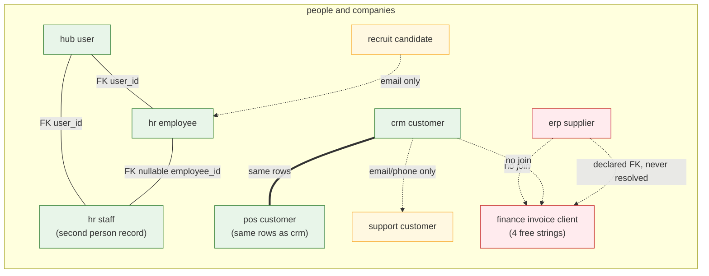

# 02. The entity graph

Who owns which noun, who references it, and which references are real foreign
keys versus loose strings. Source data: `inventory/entities.csv` and
`inventory/contracts.csv`, both generated in Phase 1. Backend claims are
verified against `~/Development/onion` (read-only) and cited to file:line.

`common` contributes no id-bearing entity of its own (it holds auth and
pagination wrappers), so 11 of the 12 domains own entities.

## Entity ownership

178 entities. Count by owning domain:

| Domain   | Entities | Notes                                                                   |
| -------- | -------- | ----------------------------------------------------------------------- |
| hr       | 42       | the largest domain, and the one with a duplicated person record (below) |
| hub      | 28       | tenant, user, team, billing, config                                     |
| pos      | 25       | serves the separate POS repo, not an app here                           |
| flow     | 23       | workspace, project, task, cycle, work day                               |
| finance  | 17       | invoice, bill, expense, journal                                         |
| erp      | 17       | product, supplier, warehouse, price list                                |
| crm      | 10       | customer, campaign, segment, loyalty                                    |
| booking  | 6        | no app in this repo                                                     |
| console  | 4        | internal admin                                                          |
| support  | 3        | no app in this repo                                                     |
| insights | 3        | read-only projections, owns almost nothing                              |

136 of the 178 carry at least one id-shaped field. 723 id-shaped fields exist
in total across all messages, spanning 120 distinct field names.

## Cross-domain references that exist in the contracts today

41 fields in non-request/response messages reference an entity owned by a
different domain. Grouped by direction, with the doc comment where the
contract explains itself:

| Reference                                             | Type   | Target               | Cited                                                    |
| ----------------------------------------------------- | ------ | -------------------- | -------------------------------------------------------- |
| `flow.WorkType.hr_category_id`                        | int64? | hr payroll category  | `packages/voxie/api/flow/time/v1/models.onk:21`          |
| `flow.WorkDay.employee_id`                            | int64  | hr employee          | `packages/voxie/api/flow/time/v1/models.onk:38`          |
| `flow.WorkDay.user_id`                                | int64? | hub user             | `packages/voxie/api/flow/time/v1/models.onk:43`          |
| `flow.ProjectMember.user_id`                          | int64  | hub user             | `packages/voxie/api/flow/project/v1/models.onk:65`       |
| `flow.TaskComment.user_id`                            | int64  | hub user             | `packages/voxie/api/flow/task/v1/models.onk:76`          |
| `flow.TaskActivity.user_id`                           | int64  | hub user             | `packages/voxie/api/flow/task/v1/models.onk:93`          |
| `flow.TimeLog.user_id`                                | int64  | hub user             | `packages/voxie/api/flow/task/v1/models.onk:142`         |
| `flow.WorkspaceMember.user_id`                        | int64  | hub user             | `packages/voxie/api/flow/workspace/v1/models.onk:37`     |
| `hr.TimeEntryPayload.project_id`                      | int64  | flow project         | `packages/voxie/api/hr/time_entry/v1/models.onk:12`      |
| `hr.TimeEntryPayload.task_id`                         | int64  | flow task            | `packages/voxie/api/hr/time_entry/v1/models.onk:14`      |
| `hr.EmployeePayload.user_id`                          | int64  | hub user             | `packages/voxie/api/hr/employee/v1/models.onk:10`        |
| `hr.UpdateEmployeeBody.user_id`                       | int64  | hub user             | `packages/voxie/api/hr/employee/v1/models.onk:133`       |
| `hr.Staff.user_id`                                    | int64  | hub user             | `packages/voxie/api/hr/staff/v1/models.onk:7`            |
| `finance.Bill.supplier_id`                            | int64  | erp supplier         | `packages/voxie/api/finance/bill/v1/models.onk:10`       |
| `finance.UpdateBillBody.supplier_id`                  | int64  | erp supplier         | `packages/voxie/api/finance/bill/v1/models.onk:80`       |
| `booking.Appointment.staff_id`                        | int64  | hr staff             | `packages/voxie/api/booking/appointment/v1/models.onk:9` |
| `insights.RoadmapProject.project_id`                  | int64  | flow project         | `packages/voxie/api/insights/dashboard/v1/models.onk:20` |
| `insights.StaffUtilization.staff_id`                  | int64  | hr staff             | `packages/voxie/api/insights/operation/v1/models.onk:22` |
| `insights.WorkloadEntry.user_id`                      | int64  | hub user             | `packages/voxie/api/insights/dashboard/v1/models.onk:5`  |
| `insights.BestSeller.product_id`                      | int64  | erp product          | `packages/voxie/api/insights/product/v1/models.onk:5`    |
| `insights.SlowMover.product_id`                       | int64  | erp product          | `packages/voxie/api/insights/product/v1/models.onk:16`   |
| `pos.Order.customer_id`                               | int64  | crm customer         | `packages/voxie/api/pos/orders/v1/models.onk:35`         |
| `pos.Order.staff_id`                                  | int64  | hr staff             | `packages/voxie/api/pos/orders/v1/models.onk:37`         |
| `pos.Order.location_id`                               | int64  | see "location" below | `packages/voxie/api/pos/orders/v1/models.onk:30`         |
| `pos.GiftCard.customer_id`                            | int64  | crm customer         | `packages/voxie/api/pos/gift_card/v1/models.onk:11`      |
| `pos.LoyaltyTransaction.customer_id`                  | int64  | crm customer         | `packages/voxie/api/pos/loyalty/v1/models.onk:24`        |
| `pos.StockMovement.product_id`                        | int64  | erp product          | `packages/voxie/api/pos/stock/v1/models.onk:8`           |
| `pos.BranchInventory.product_id`                      | int64  | erp product          | `packages/voxie/api/pos/stock/v1/models.onk:25`          |
| `pos.AuditLog.employee_id`                            | int64  | hr employee          | `packages/voxie/api/pos/audit/v1/models.onk:9`           |
| `pos.CashMovement.employee_id`                        | int64  | hr employee          | `packages/voxie/api/pos/cash/v1/models.onk:10`           |
| `pos.StockMovement.employee_id`                       | int64  | hr employee          | `packages/voxie/api/pos/stock/v1/models.onk:15`          |
| `pos.Session.staff_id`, `pos.CurrentSession.staff_id` | int64  | hr staff             | `packages/voxie/api/pos/session/v1/models.onk:9`, `:29`  |
| `pos.RosterEntry.user_id`                             | int64  | hub user             | `packages/voxie/api/pos/access/v1/models.onk:14`         |

Remaining rows are further `pos.*.location_id` occurrences
(`packages/voxie/api/pos/access/v1/models.onk:5` and `:29`,
`packages/voxie/api/pos/session/v1/models.onk:8`,
`packages/voxie/api/pos/table/v1/models.onk:8` and `:37`,
`packages/voxie/api/pos/user/v1/models.onk:7`).

Outbound cross-domain reference counts, which is a rough measure of how much
each domain already "knows about" its neighbours:

| Domain                          | Outbound refs | Points at          |
| ------------------------------- | ------------- | ------------------ |
| pos                             | 17            | hr, crm, erp, hub  |
| flow                            | 8             | hr, hub            |
| insights                        | 5             | flow, hr, erp, hub |
| hr                              | 5             | flow, hub          |
| finance                         | 2             | erp                |
| booking                         | 1             | hr                 |
| crm, erp, hub, support, console | 0             | nothing            |

**crm, erp and support reference no other domain at all.** They are pure
producers. Every connection involving them as a consumer is new ground.

## A declared foreign key is not a working join

Three of the references above are declared in the contract and never resolved
by the backend. This is the single most important calibration fact in the
audit, because it sets the base rate for "if we add a contract field, will
anything consume it".

### `flow.WorkType.hr_category_id`: dead

Documented as mapping a Flow work type onto an HR payroll category "so one
entry serves both project reporting and payroll"
(`packages/voxie/api/flow/time/v1/models.onk:5`).

| Stage                         | Status          | Evidence                                                                                                                         |
| ----------------------------- | --------------- | -------------------------------------------------------------------------------------------------------------------------------- |
| Contract declares it          | yes             | `packages/voxie/api/flow/time/v1/models.onk:21`                                                                                  |
| Column exists                 | yes             | `~/Development/onion/internal/platform/database/schemas/flow/v8_time_tracking.sql:72`                                            |
| Backend writes it             | yes             | `~/Development/onion/internal/modules/workspaces/internal/api/worktime_service.go:381`                                           |
| Backend reads it back         | only to echo it | `~/Development/onion/internal/modules/workspaces/internal/api/worktime_service.go:149`                                           |
| Payroll consumes it           | **no**          | `hr_payroll` reads `hr_employees`, `hr_overtime_*`, `hr_payroll_*`, `hr_timesheets` only; `hr_category_id` appears nowhere in it |
| Any frontend sets or shows it | **no**          | the only frontend occurrences are in generated code, `packages/voxie/gen/ts/flow/time/v1/types.ts:9` and its serialisers         |

**Verdict: dead field.** It is stored and echoed. No payroll code reads it, no
UI writes it. A contract field that has existed long enough to be documented in
prose has never been consumed. Treat any proposal whose entire value depends on
a newly added contract field with corresponding scepticism, and prefer shapes
that put the consumer and the join in the same change.

### `finance.Bill.supplier_id`: declared, never joined, and actively misused

`finance.Bill` carries `supplier_id: int64` as `@required @gt(0)`
(`packages/voxie/api/finance/bill/v1/models.onk:10`,
`packages/voxie/api/finance/bill/v1/models.onk:29`) but has **no supplier
name field**. The backend never joins it: the `bills` module touches only
`finance_bills` (verified by sweeping its SQL), never `erp_suppliers`.

The frontend's response is worth reading in full, because it is the audit's
clearest example of a missing connection producing a fabricated one. Finance's
bill list comments the gap explicitly and substitutes the description field for
the vendor name (`apps/finance/src/features/bills/useBills.ts:13`), and the
create form manufactures an id by slugifying whatever the user typed:

```
const derivedSupplierId =
  form.vendor.trim().toLowerCase().replace(/[^a-z0-9]/g, '-') || '1';
```

`apps/finance/src/features/bills/Bills.tsx:59`

That value is sent as `supplier_id`. OneKit encodes `int64` as a **string on
the wire** (`~/Development/voxie/gen/go/finance/bill/v1/types.gen.go:28`,
which marshals via `strconv.FormatInt`), and the server validates
`SupplierId <= 0`
(`~/Development/voxie/gen/go/finance/bill/v1/validate.gen.go:39`). A slug like
`acme-corp` cannot parse as an int64, and the empty-vendor fallback `'1'`
posts a bill against supplier id 1 regardless of who the supplier is.

**Inferred, not verified: creating a bill with a non-numeric vendor name fails
with a 400 on unmarshal, and creating one with a blank vendor silently
attributes it to supplier 1.** Verifying needs one request against a real
backend, which this audit deliberately does not make. Either way the ERP
supplier list is never consulted, and the user retypes a vendor that ERP
already holds.

### `booking.Appointment.staff_id`: no consumer surface

The field exists (`packages/voxie/api/booking/appointment/v1/models.onk:9`)
and the `booking_*` modules exist, but there is no booking app in `apps/`, so
nothing renders it. Not a broken link, an unbuilt one.

## The one link that does work end to end

The same Flow/HR area contains a genuinely live shared-row pipeline, which is
the counterexample that makes the dead field above diagnostic rather than
fatalistic.

`flow.time.v1`'s service doc claims "Lines persist as HR time entries, so Flow
and payroll read the same rows rather than reconciling two stores"
(`packages/voxie/api/flow/time/v1/service.onk:6`). The first half is true: the
`workspaces` module, which serves `flow/time/v1`, writes directly into
`hr_time_entries` alongside its own `flow_work_days` and `flow_work_types`
(verified by sweeping `~/Development/onion/internal/modules/workspaces/sql/queries/worktime.sql`,
whose statements touch `flow_work_days`, `flow_work_types`, `hr_employees` and
`hr_time_entries`).

The second half is false. `hr_payroll` never reads `hr_time_entries`. It reads
`hr_timesheets.total_minutes`
(`~/Development/onion/internal/modules/hr_payroll/internal/application/service.go:186`),
and that column is carried through from the client rather than aggregated from
entries (`~/Development/onion/internal/modules/hr_time/internal/infrastructure/repository.go:215`).
The only query that joins entries to timesheets is a reminder job looking for
people who have not submitted
(`~/Development/onion/internal/modules/hr_time/sql/queries/timesheets.sql:66`).

So: Flow hours land in HR's time-entry table, and payroll prices a separately
supplied number. The pipeline exists and stops one table short of the money.

**Payroll already multiplies hours by a rate.**
`basePay = hoursWorked * hourlyRateDollars`
(`~/Development/onion/internal/modules/hr_payroll/internal/application/service.go:221`),
with the rate coming from the employee record
(`hr_employees.hourly_rate`, `~/Development/onion/internal/platform/database/schemas/hr_core/schema.sql:91`).
Every input for "what did this project cost in labour" is already in the
database. Nothing joins hours-by-project to rate-by-person.

There is even an unused export for it: `GET /hr/time-entries/export-billable`
returns per-entry `project_id`, `task_id`, `employee_id`, `duration_minutes`
and `is_billable`
(`~/Development/onion/internal/modules/hr_time/internal/domain/types.go:90`,
route at `~/Development/onion/internal/modules/hr_time/internal/routes/handlers/export_billable_handler.go:15`).
**No frontend calls it** (zero occurrences in `apps/**` and zero rows in
`inventory/endpoints.csv`). It carries hours and billability but no rate and no
amount.

## Identity resolution

The brief names seven person-or-company entities. There are in fact **eight**,
because HR stores a person twice.

| #   | Entity            | Source                                                                                  | Identity fields                                                                         |
| --- | ----------------- | --------------------------------------------------------------------------------------- | --------------------------------------------------------------------------------------- |
| 1   | hub user          | `packages/voxie/api/hub/user/v1`                                                        | `id`; the canonical login identity                                                      |
| 2   | hr employee       | `packages/voxie/api/hr/employee/v1/models.onk:4`                                        | `id`, `user_id`, `department_id`, `location_id`, `manager_id`                           |
| 3   | **hr staff**      | `packages/voxie/api/hr/staff/v1/models.onk:4`                                           | `id`, `user_id`, `department_id`, plus `salary`, `hourly_rate`, `overtime_rate`, `apps` |
| 4   | crm customer      | `packages/voxie/api/crm/customer/v1/models.onk:4`                                       | `id`, `email`, `phone`, `first_name`, `last_name`                                       |
| 5   | pos customer      | `packages/voxie/api/pos/customer/v1/models.onk:6`                                       | `id`, `email`, `phone`, `first_name`, `last_name`                                       |
| 6   | support customer  | `packages/voxie/api/support/customer/v1/models.onk:3`                                   | `id`, `name`, `email`, `phone`                                                          |
| 7   | erp supplier      | `erp_suppliers` table; `erp` domain                                                     | `id`                                                                                    |
| 8   | recruit candidate | `~/Development/onion/internal/platform/database/schemas/recruit/recruit_v1_base.sql:80` | `id`, `candidate_name`, `email`, `phone`, `status`                                      |

### Two employee records inside HR

`hr_staff` and `hr_employees` are different tables
(`~/Development/onion/internal/platform/database/schemas/hr/schema.sql:15` and
`~/Development/onion/internal/platform/database/schemas/hr_core/schema.sql`
respectively). The `staff` module reads both. Both carry `user_id`, and
**both carry `salary`, `hourly_rate` and `overtime_rate`**
(`~/Development/onion/internal/platform/database/schemas/hr/schema.sql:30` and
`~/Development/onion/internal/platform/database/schemas/hr_core/schema.sql:91`). They
are bridged by one nullable column, `hr_staff.employee_id`
(`~/Development/onion/internal/platform/database/schemas/hr/schema.sql:20`),
which may be NULL.

The consequence is not theoretical. Different HR features key on different
ids:

- Time off keys on `staff_id` (`packages/voxie/api/hr/time_off/v1/models.onk:7`;
  column at `~/Development/onion/internal/platform/database/schemas/hr/schema.sql:55`).
- Payroll and Flow work days key on `employee_id`
  (`~/Development/onion/internal/modules/hr_payroll/internal/application/service.go:198`;
  `packages/voxie/api/flow/time/v1/models.onk:38`).

So "is this person on approved leave" and "how many hours did this person log
against a project" are answered in two id spaces joined by a nullable column.
Any leave-gates-assignment feature has to cross that bridge first. **This is a
prerequisite for several otherwise-simple proposals, and it is the reason the
identity work is its own wave rather than a line item.**

There is one working resolver: `SELECT id FROM hr_employees WHERE business_id
= ? AND user_id = ?`
(`~/Development/onion/internal/modules/hr_core/sql/queries/employees.sql:47`),
which turns a hub user into an hr employee. That is the only
identity-resolution query found anywhere in the backend.

### The customer triangle

- **pos customer and crm customer are the same rows.** The POS customers module
  does a documented cross-schema read straight out of `crm_customers`
  (`~/Development/onion/internal/modules/pos_customers/internal/infrastructure/repository.go:30-33`).
  The POS contract even documents the name collision and warns about it
  (`packages/voxie/api/pos/customer/v1/models.onk:3`). So `pos.Order.customer_id`
  is a real join to CRM. This is the product's best existing cross-domain link.
- **support customer is a different table.** `support_customers` is its own
  table with its own `id`, `name`, `email`, `phone`, `total_tickets`
  (`packages/voxie/api/support/customer/v1/models.onk:3`; table confirmed by
  sweeping the `support_customers` module SQL). Nothing joins it to
  `crm_customers`.
- **finance invoices reference no customer at all.** `finance.Invoice` stores
  `client_name`, `client_email`, `client_address`, `client_tax_id` as free
  strings (`packages/voxie/api/finance/invoices/v1/models.onk:146-153`, where
  `client_name` and `client_email` are `@required`). There is no `customer_id`
  anywhere in the invoices contract.
- **support inbox does the same**, storing `customer_name` and `customer_email`
  strings (`packages/voxie/api/support/inbox/v1/models.onk:5-6`).

### Pairwise joinability

`=` same rows, `FK` real foreign key, `~` loose string only (email/phone/name),
`x` no join of any kind. Read row-to-column.

|                      | hub user | hr employee               | hr staff                           | crm cust | pos cust    | support cust  | erp supplier | candidate    |
| -------------------- | -------- | ------------------------- | ---------------------------------- | -------- | ----------- | ------------- | ------------ | ------------ |
| **hub user**         | -        | FK `hr_employees.user_id` | FK `hr_staff.user_id`              | x        | x           | x             | x            | x            |
| **hr employee**      | FK       | -                         | FK nullable `hr_staff.employee_id` | x        | x           | x             | x            | ~ email only |
| **hr staff**         | FK       | FK nullable               | -                                  | x        | x           | x             | x            | ~ email only |
| **crm customer**     | x        | x                         | x                                  | -        | = same rows | ~ email/phone | x            | x            |
| **pos customer**     | x        | x                         | x                                  | =        | -           | ~ email/phone | x            | x            |
| **support customer** | x        | x                         | x                                  | ~        | ~           | -             | x            | x            |
| **erp supplier**     | x        | x                         | x                                  | x        | x           | x             | -            | x            |
| **candidate**        | x        | ~ email                   | ~ email                            | x        | x           | x             | x            | -            |

Finance's invoice client is deliberately absent from the matrix: it is not an
entity, it is four strings on an invoice row, and it joins to nothing by
construction.

Counting the 28 unordered pairs: 4 are real joins (three of them inside the
hub/hr cluster), 1 is an identity (crm/pos), 5 are loose-string-only, and 18
have no join at all.



Solid edges are real joins, dashed are loose or absent.

## Places and money

**Location is three unrelated tables.** `hr_locations`
(`~/Development/onion/internal/platform/database/schemas/hr_core/schema.sql:31`),
`pos_locations`
(`~/Development/onion/internal/platform/database/schemas/pos/schema.sql:1`) and
`erp_warehouses`
(`~/Development/onion/internal/platform/database/schemas/erp/warehouses.sql:1`).
The `pos_locations` module reads only `pos_locations`. So the 8
`pos.*.location_id` fields point at POS's own locations, not HR's, and the
audit's earlier attribution of those fields to `hr` is wrong in the
mechanical pass and corrected here: **`pos.location_id` means a POS location.**
Whether a POS location, an HR location and an ERP warehouse describe the same
physical site is a question the schema cannot answer, and no column relates
them.

**There is no single currency authority.** `erp.settings` has a `@required`
`currency` (`packages/voxie/api/erp/settings/v1/models.onk:7`). Finance carries
`currency` per invoice, per bill and per reconciliation row
(`packages/voxie/api/finance/invoices/v1/models.onk:40`,
`packages/voxie/api/finance/bill/v1/models.onk:14`). ERP products and price
lists each carry their own (`packages/voxie/api/erp/product/v1/models.onk:28`,
`packages/voxie/api/erp/price_list/v1/models.onk:7`). **HR payroll and POS
carry no currency field at all**, so payroll amounts and POS takings are
implicitly whatever the reader assumes. Finance stores money as
`float64` in its contracts while payroll works in integer cents internally
(`~/Development/onion/internal/modules/hr_payroll/internal/application/service.go:236`),
so any cross-domain money figure crosses a representation boundary as well as
a currency one. Every derivation proposal in this audit that combines payroll
with finance has to state its rounding, and they do.

## What this means for the rest of the audit

1. **Identity first.** 18 of 28 entity pairs have no join. Most
   "context in place" proposals about a customer or a person are blocked or
   degraded by that, which is why `08-roadmap.md` puts identity in its own
   wave rather than treating it as one connection.
2. **Prefer shapes where the join and its consumer ship together.**
   `hr_category_id` proves that a field added ahead of its consumer stays
   unconsumed.
3. **The Flow/HR/Finance labour-cost chain is one table short, not missing.**
   Hours, project attribution, billability and rates all exist. That makes it a
   cheap derivation rather than a new concept, and it is why the seed case in
   the brief turned out to be real. It is not, however, the highest-leverage
   item; see `08-roadmap.md`.
4. **Free-text where an id belongs is the product's dominant double-entry
   pattern**: invoice clients, support inbox customers, and bill suppliers are
   all typed by a human into a field that another domain already holds as a row.
