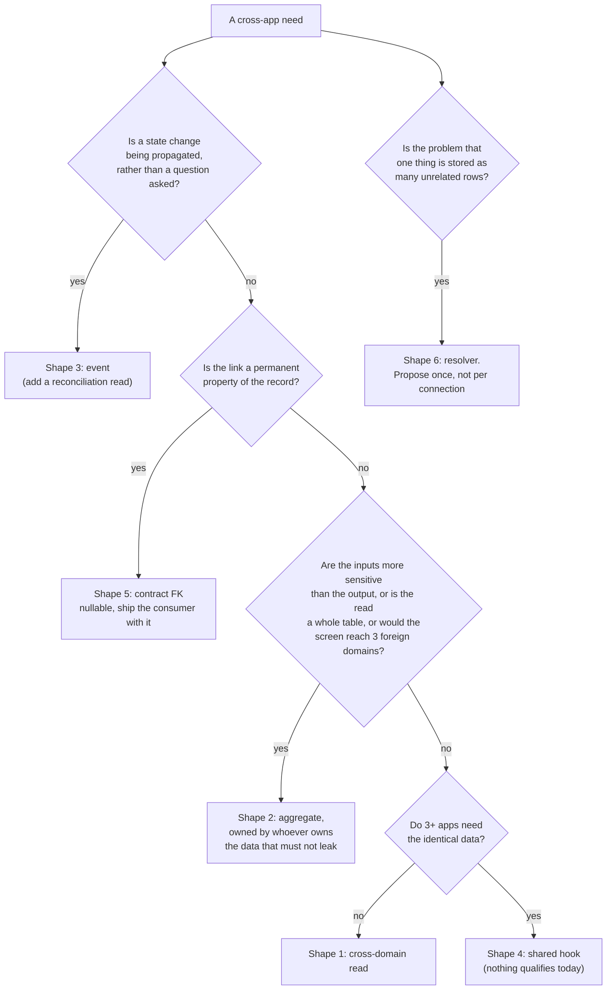

# 07. Plumbing blueprints

The six shapes a cross-app connection can take in this codebase, **ordered
loosest first**. Rule 1 of the coupling discipline requires taking the first
shape that satisfies the case, and requires a dossier to say why a looser one
was insufficient if it reaches for a tighter one.

Which proposals use which shape is in `05-connections/README.md`. The
distribution is worth noting before the detail: **7 proposals use shape 1, 4
use shape 2, 3 use shape 3, none use shape 4, 3 use shape 5, and 2 use shape 6.**
That shape 4 is empty is a result, not an oversight; see below.

## Before any of them: three facts about this codebase

**1. There are two different gates, and they are not interchangeable.**

| Mechanism                           | What it actually gates                                                                                                       | Where                                        |
| ----------------------------------- | ---------------------------------------------------------------------------------------------------------------------------- | -------------------------------------------- |
| `AppFlagGuard` / `resolveFlag`      | whether an app is **launched** at all, resolved from PostHog, then a `VITE_APP_*_ENABLED` env var, then a hard-coded default | `packages/config/src/appGuards.tsx:44`       |
| `hub.App.is_enabled` / `listAddons` | whether **this tenant** has the app or add-on                                                                                | `packages/voxie/api/hub/app/v1/models.onk:8` |
| `APP_CONFIG[app].allowedRoles`      | **nothing. It is dead code**, never consulted outside its own declaration; already filed as issue #795                       | `packages/config/src/apps.ts:34`             |
| the per-user `apps` array           | the **real** app-entry boundary: owner and admin bypass, everyone else needs the app id in their own `apps` array            | `packages/auth/src/guards/AppGuard.tsx:173`  |

The brief asks for degrade behaviour to be checked against `AppFlagGuard` and
`APP_CONFIG`. Neither is the per-tenant licence, and one of them is not a gate
at all: **`APP_CONFIG.allowedRoles` is never consulted.** Repo-wide, the only
`allowedRoles` references outside its own declaration are inside an unused
helper module (`the permission helper (file deleted in the #795 close-out)`). This was already
found and filed as issue #795, and confirmed independently here.

So for "does this tenant have ERP" the signal is **hub**, and for "may this
person use it" the signal is the per-user `apps` array in `AppGuard`
(`packages/auth/src/guards/AppGuard.tsx:173`). A dossier that said "check
`APP_CONFIG`" would be citing dead code.

Note also `allFeaturesEnabled()`: self-hosted installs short-circuit every flag
to true (`packages/config/src/appGuards.tsx:50`). A degrade path that only ever
runs when a flag is false will therefore never run on self-host, so **degrade
behaviour must not depend on the flag being false to be correct.** It has to
handle the data simply being absent.

The working precedent for a per-tenant gate is CRM's sales add-on guard, which
reads hub add-ons and redirects when the add-on is off
(`apps/crm/src/router.tsx:221`). It caches for five minutes and treats a failed
read as "not enabled" by returning an empty list in a `catch`
(`apps/crm/src/router.tsx:228`). **Copy the caching, not the fallback:** for a
cross-app _panel_, a failed read should hide the panel, which is what that
fallback achieves, but for anything gating a _user's own work_ the same
pattern would lock people out on a transient error.

**2. Query keys have no cross-domain convention yet.**

The root `CLAUDE.md` convention assumes one domain: `['team']`,
`['team', userId]`, `['team', 'filter', {...}]`. Apps already deviate when
reaching outside themselves, for example `['crm-addons']`
(`apps/crm/src/router.tsx:223`) and `['flow-team']`
(`apps/flow/src/shared/hooks/queries/useFlowTeam.ts:83`), which prefix with an
app or domain name.

**This audit proposes making that explicit.** A cross-domain key is prefixed
with the foreign domain:

```ts
// Own domain: unchanged, per the root CLAUDE.md convention.
queryKey: ['invoices'];
queryKey: ['invoice', invoiceId];

// Foreign domain: prefix with the domain that owns the data.
queryKey: ['erp', 'suppliers'];
queryKey: ['erp', 'supplier', supplierId];
queryKey: ['hr', 'leave', 'range', { from, to }];
queryKey: ['hr', 'cost', 'project', { projectIds, from, to }];
```

Two reasons this matters more than tidiness. It makes a foreign read visible in
a review diff, and it makes the invalidation rule below expressible: a consumer
may invalidate `['erp', ...]` freely, because those keys are its own cache of
someone else's data, and it must never assume invalidating them changes anything
on the producer.

**3. There is a realtime channel, and it is per-user and per-project.**

`packages/api/src/realtime.ts` multiplexes topics such as `user:<id>` and
`project:<id>` over one shared WebSocket
(`packages/api/src/realtime.ts:5`), with `subscribe(topic, handler)` returning
an unsubscribe (`packages/api/src/realtime.ts:144`). This is the only existing
push mechanism reaching the browser, and shape 3 should use it for
user-visible consequences rather than inventing a second one.

---

## Shape 1. Cross-domain read from one app

**The default answer.** App B calls A's existing RPC and renders it. No new
backend, no new contract, no shared code.

**Used by:** `ERP->FIN-01`, `ERP->FIN-02`, `ERP->FIN-03`, `FLOW->FIN-01`,
`HR->FLOW-02`, `CRM->FIN-01`, `FIN->CRM-01`, `FIN->ERP-01`, `SUP->CRM-01`,
`REC->HR-01`, `HR->FIN-01` (read half).

**Where the code goes.** In the consuming app, beside its own query hooks:
`apps/<consumer>/src/shared/hooks/queries/use<Foreign><Thing>.ts`. ERP is the
exception and puts hooks beside the feature
(`apps/erp/src/features/reorder/useReorderSuggestions.ts`), so follow the local
convention.

Reference sketch, using the OneKit idiom because a foreign domain always has a
generated client:

```ts
// apps/finance/src/shared/hooks/queries/useErpSuppliers.ts
import { createOneKitClient } from '@voxire/api';
import { useQuery } from '@tanstack/react-query';
import { SupplierServiceClient } from '@voxire/voxie/erp/supplier/v1/client';
import type { Supplier } from '@voxire/voxie/erp/supplier/v1/types';

// One client per foreign service, at module scope, matching the existing
// pattern in apps/erp and apps/crm.
const supplierClient = createOneKitClient(SupplierServiceClient, 'finance');

export function useErpSuppliers(enabled: boolean) {
  return useQuery<Supplier[]>({
    // Foreign-domain key: prefixed with the owning domain.
    queryKey: ['erp', 'suppliers'],
    queryFn: async () => (await supplierClient.listSuppliers({})).suppliers ?? [],
    // Foreign reference data changes rarely and is not this app's
    // responsibility to keep fresh.
    staleTime: 5 * 60 * 1000,
    // The degrade switch: never fire the request when the tenant has no ERP.
    enabled,
  });
}
```

**Permissions and tenancy.** Enforced entirely by the producing domain's own
handler, which is the point: the consumer gains no privilege by calling. The
consumer must not filter client-side and present the result as complete.

**Cache invalidation.** The consumer owns its cache of foreign data and nothing
more. Rules:

- After a mutation in **its own** domain, invalidate its own keys as usual.
- It may invalidate `['<foreign>', ...]` to force a refetch, but **must not
  assume the foreign domain changed**, and must never invalidate on behalf of
  another app: there is no shared client state across apps (rule 7).
- Cross-app agreement happens on the server. If Finance creates a bill, ERP's
  supplier list in a different tab does not update, and that is correct.
- Use `staleTime` generously for foreign reference data. The five minutes in
  `apps/crm/src/router.tsx:232` is a reasonable default.

**Degrade when the producer is off.** Pass `enabled: false` so no request is
made, and render nothing rather than an empty or zero value. Two dossiers make
this a correctness requirement rather than a nicety: a balance sheet must not
show zero inventory (`ERP->FIN-02`) and a margin chart must not plot zero cost
(`HR->INS-01`).

```tsx
// The panel decides whether it exists at all, before it asks for data.
const hasErp = useTenantHasApp('erp');
const { data: suppliers } = useErpSuppliers(hasErp);
if (!hasErp) return null;
```

**When shape 1 is not enough:** the producer's data is more sensitive than the
consumer's audience (go to 2), the read would be a whole table (go to 2), the
screen would then read three foreign domains (go to 2), or nobody is asking a
question because a state change needs propagating (go to 3).

## Shape 2. A backend aggregate endpoint, owned by the consuming domain

**Used by:** `HR->FLOW-01`, `HR->INS-01`, `ERP->INS-01`, `POS->CRM-01`. Note
that in the first two the endpoint is owned by the **producing** domain (hr)
even though the consumer asked for it, because the sensitive inputs are hr's.
That is the deliberate variation: **ownership follows the data that must not
leak, not the app that wants the answer.**

**Where the code goes.** A new capability in the owning domain's contracts
(`packages/voxie/api/<domain>/<capability>/v1/`) and its onion module. Drafts
for `hr.cost.v1` and `ProductMargin` are in `06-proposed-contracts.md` items 8a
and 8b.

**Why it exists.** Three triggers, each of which appears in a real dossier:

1. **The inputs are more sensitive than the output.** `hr.cost.v1` returns a
   project total and never per-person rates, because `hr.Staff` exposes
   `salary`, `hourly_rate` and `overtime_rate`
   (`packages/voxie/api/hr/staff/v1/models.onk:17`) and a client-side
   multiplication would put those in the browser of every Flow member.
2. **The join is expensive or unbounded.** `ERP->INS-01` would otherwise fetch
   the product catalogue per report.
3. **Rule 5 would otherwise break.** A screen may synchronously read at most
   two foreign domains. The CRM customer page is where this binds: invoices,
   tickets and orders are three.

**Permissions and tenancy.** Enforced in the owning domain's handler, and this
is the shape's main advantage: the authorisation lives next to the join, where
it can be tested, rather than being implied by which app made the call. Two
requirements the drafts encode:

- Return aggregates that cannot be trivially reversed, and where they can be,
  say so. `ProjectLabourCost.contributor_count` exists precisely so a consumer
  can suppress a one-person total from which a salary is derivable.
- Report coverage. `rate_coverage` exists so a partial total is labelled rather
  than silently understated.

**Cache invalidation.** Key it by the owning domain and its parameters:

```ts
queryKey: ['hr', 'cost', 'project', { projectIds, from, to }];
```

An aggregate is derived, so it goes stale when either input changes and the
consumer cannot know when. Use a `staleTime` matched to how the number is used
(minutes for a panel, longer for a report) and offer an explicit refresh rather
than pretending it is live.

**Degrade.** Same as shape 1 at the call site. Additionally, the aggregate must
be honest when its own inputs are missing: omit projects with no logged time
rather than returning zero, which is why
`GetProjectLabourCostResponse` returns only projects that had time.

## Shape 3. An event or webhook

**Used by:** `HR->HUB-01`, `FIN->ERP-02`, and `HR->FIN-01` in the sense that a
future automatic version would need one.

**Check what exists first.** The backend already has a `webhooks` module and a
`notifications` module (`~/Development/onion/internal/modules/webhooks`,
`~/Development/onion/internal/modules/notifications`), and the frontend has the
realtime channel described above. **Survey all three before adding a fourth
mechanism.** This audit did not establish which of them is the right substrate,
and says so rather than guessing: that is a decision for whoever owns the
backend platform.

**Where the code goes.** Producer emits; consumer subscribes. Both in onion.
The frontend is not part of the mechanism, though it may learn the outcome
through `realtime.ts`.

**The honest caveat about this shape.** Both `HR->HUB-01` and `FIN->ERP-02`
involve modules that live in the **same Go binary**, so a direct in-process call
is simpler and both dossiers say so. The argument for an event is ownership:
HR should not have to know every consumer of "employment ended". **If the team
prefers direct calls for the first version, that is a defensible narrowing**,
and the dossiers say which parts matter more than the mechanism (the
reconciliation report, in `HR->HUB-01`'s case).

Whichever is chosen, **choose the same one for both proposals.** Two event
styles for two connections is worse than either.

**Permissions and tenancy.** The event payload must carry `business_id` and the
consumer must scope by it. `HR->HUB-01` flags this as its highest risk: a user
who belongs to two businesses must lose access to the terminating tenant only,
or a consultant is locked out of every client.

**Delivery concerns this shape adds, and shapes 1 and 2 do not have.**

- **Idempotency.** Events arrive twice. `FIN->ERP-02` closing a purchase order
  must be idempotent.
- **Ordering.** A later correction must be able to reverse an earlier
  consequence: terminations get reversed, bills get un-paid.
- **Retry and failure.** A dropped event means the consequence never happens,
  which for `HR->HUB-01` means access is not revoked. **Hence the
  reconciliation read in that dossier: an event needs an audit that catches
  what it missed.** Treat the reconciliation query as part of the shape, not an
  extra.

**Cache invalidation across apps.** An event cannot invalidate another app's
React Query cache: separate deploys, separate tabs (rule 7). If the consequence
must be visible immediately, the consuming app learns through `realtime.ts` on
a topic it already subscribes to, and invalidates its own keys in that handler.
Otherwise it appears on next fetch.

**Degrade.** Events are additive: their absence is today's behaviour. This makes
shape 3's degrade story the easiest of the six, and it is the reason
`HR->HUB-01` can ship without any app becoming conditional on HR existing.

## Shape 4. A shared query hook in `packages/`

**Used by: nothing. Deliberately.**

The bar is three or more apps needing the identical data **and** a stable shape.
The closest candidate is the `hr.cost.v1` aggregate, wanted by Flow
(`HR->FLOW-01`) and Insights (`HR->INS-01`). **Two apps is not three**, so both
dossiers specify duplicating a small hook instead.

**Why the bar is that high here.** Any change under `packages/**` redeploys all
ten Cloudflare Pages apps. A shared hook trades a little duplication for a
shared deploy risk across the whole product.

There is also a concrete obstacle nobody would discover until they tried:
**pagination is not consistent across domains.** `hr` uses `limit`/`offset`
(`packages/voxie/api/hr/employee/v1/models.onk:115`) while `finance`, `erp` and
`pos` use `page`/`page_size`
(`packages/voxie/api/finance/bill/v1/models.onk:66`,
`packages/voxie/api/erp/purchase_order/v1/models.onk:44`,
`packages/voxie/api/pos/orders/v1/models.onk:153`). A shared paginated
cross-domain hook cannot have one pagination helper, so the shape is more
expensive than it looks.

**If it is ever justified:** put it in `packages/components` beside
`useLicenseState` (`packages/components/src/license/useLicenseState.ts`), which
is the existing precedent for a shared hook that does a request, and keep the
query key convention above so consumers' caches stay independent.

## Shape 5. A contract-level foreign key

**Used by:** `CRM->FIN-02`, `ERP->POS-01`, `FIN->ERP-02` (the field half).

**When.** The link is a durable product concept rather than a screen. An
invoice's customer and a menu item's product are permanent properties of those
records; a panel showing related data is not.

**Where the code goes.** Voxie contracts first, then the packages submodule
pointer, then this repo's pointer (root `CLAUDE.md`, submodules). Drafts in
`06-proposed-contracts.md`.

**The rules every draft here follows**, all of them learned from existing
mistakes in this codebase:

1. **Nullable, always.** `finance.Bill.supplier_id` is `@required @gt(0)` on a
   link the product cannot always supply, and the frontend responded by
   slugifying a typed name into the field
   (`apps/finance/src/features/bills/Bills.tsx:59`). A required link the product
   cannot guarantee gets faked.
2. **Keep the snapshot.** Adding `customer_id` to an invoice does not remove
   `client_name`: a document that was sent must keep the name it was sent under.
3. **Ship the consumer with the field.** `flow.WorkType.hr_category_id` is
   documented as mapping Flow work types onto HR payroll categories and
   **nothing reads it** (`packages/voxie/api/flow/time/v1/models.onk:21`, traced
   in `02-entity-graph.md`). That is the base rate for a field added ahead of its
   reader.
4. **`int64` is a string on the wire.** The generated Go marshals via
   `strconv.FormatInt` (`~/Development/voxie/gen/go/finance/bill/v1/types.gen.go:32`),
   so a JSON number fails to unmarshal and `"0"` fails `@gt(0)`. Never design a
   flow that sends a numeric id as a number, and never use `@gt(0)` on a field
   whose legitimate value can be absent.

**Permissions and tenancy.** A foreign id on a **write** path is the sharpest
risk in this shape: the server must validate that the referenced record belongs
to the caller's business, or a tenant can reference another tenant's row. Three
dossiers call this out as their highest-risk detail (`CRM->FIN-02`,
`ERP->POS-01`, `POS->CRM-01`).

**Cache invalidation.** Nothing special: the field travels with its record, so
the record's own key covers it.

**Degrade.** A null reference must behave exactly as today. That is what makes
these safe for tenants without the producing app, and it is why no proposal
here makes an existing field required.

**Migration.** Every draft is additive except the `supplier_id` relaxation.
Backfilling by fuzzy match (sku, email) is tempting and should always be a
separate reviewed migration with a report of unmatched rows, never a silent side
effect of the field landing.

## Shape 6. A shared entity resolver

**Used by:** `IDENTITY-01` and `HR->HR-01`, which is the intra-HR pilot of the
same idea.

**Proposed once, for the identity problem**, with the connections it unblocks as
its return. Not for a single connection.

**Why it is last.** It is the tightest and most expensive shape, and the only
one worth its cost at scale: 18 of 28 person-or-company entity pairs have no
join today (`02-entity-graph.md`).

**Where the code goes.** hub owns it, because hub already owns tenancy and users
and is already a universal dependency, so no new dependency direction is
created. A party concept in hub's contracts; a nullable `party_id` on each
participating domain's record.

**The sequencing is the design.** The failure mode is a widely-deployed unused
column, which is `hr_category_id` at eight times the scale. So:

1. `HR->HR-01` first: same problem inside one domain, one team, proves the
   migration approach.
2. `CRM->FIN-02` next: one nullable field with an immediate consumer.
3. Then the party concept, **with one consuming feature in the same change.**
4. Then matching, with human confirmation. Never automatic merge on email.

**Permissions, and this is the most important paragraph in this document.**
Once a party links a CRM customer to a Support customer to a Finance invoice, a
"everything about this party" view can aggregate data from domains the viewer is
not entitled to see. **The party must not become a permission bypass.** Each
domain's data stays behind that domain's own authorisation and the combined view
degrades section by section. Get this wrong and the identity work becomes
horizontal privilege escalation across the whole product.

**Tenancy.** A party is tenant-scoped. Matching across tenants, even
accidentally through a shared email domain, is a cross-tenant leak, and an
email-keyed join makes that a plausible mistake rather than an exotic one. Scope
in one place, not per call site.

**Cache invalidation.** Party membership changes rarely; cache it long. A merge
or unlink must invalidate every consumer key that used the party, which is an
argument for keying party-scoped reads as `['party', partyId, ...]` so one
prefix covers them.

**Degrade.** A record with no `party_id` must behave exactly as today, because
most records will have none for a long time. **A screen that requires a party is
a screen that breaks for existing data.**

---

## Choosing between them



## The checklist every proposal answered

Repeated here because it is the part that gets skipped:

1. Which shape, and why the next looser one was insufficient.
2. Which role may see it, and **is it enforced in the backend** rather than
   hidden in the UI.
3. What the consuming screen does when the producing app is off for that tenant,
   and specifically whether hiding is required rather than showing zero.
4. How the cache goes stale, and who invalidates what.
5. The direction of the new dependency, and its named owner.
6. Whether the screen now reads more than two foreign domains.

## Round-two addition

The backend halves of these shapes are now specified in
`17-backend-plumbing.md`, grounded in the platform ports and event substrates
that actually exist after the round-two sweep. Two corrections to the facts
this page states:

1. Shape 3's "check what exists first" list said the backend has webhooks and
   notifications modules. The webhooks module is registration CRUD only: no
   code anywhere delivers an event to a registered webhook URL
   (`16-backend-matrix.md`, async backbone). Treat tenant webhooks as absent.
2. The realtime channel note stands, but wsbus on the backend carries only UI
   topics; it is not a domain-event bus. A trigger-shaped proposal chooses
   between an in-process port call (financejournal precedent) and a
   reconciliation job (`17-backend-plumbing.md` shape B4).
