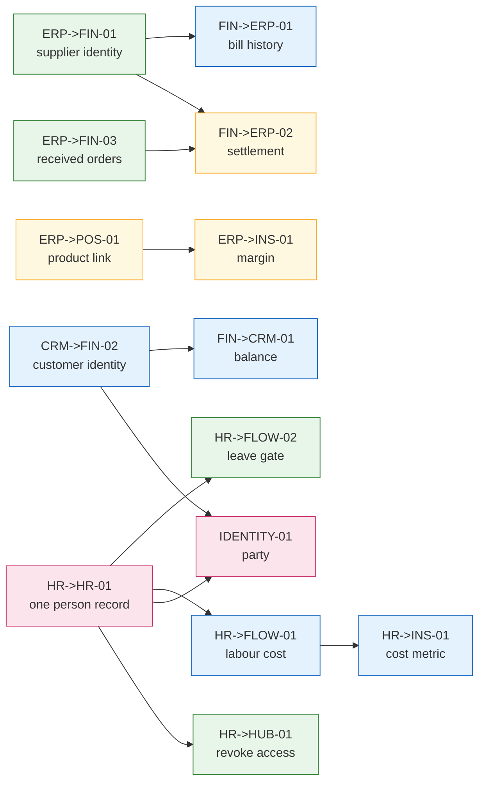

# 08. Roadmap

21 proposals, ranked and grouped into four waves. Every number below is
**modelled**, not measured, and the reference tenant it is modelled against is
defined once here and reused by every dossier so the proposals are comparable.

## The reference tenant

> **Reference tenant** (an assumption for comparability, not a real customer):
> a 40 person services business running HR, Flow, Finance and CRM, with 6 active
> projects, roughly 120 invoices and 40 bills per month, and 3 people doing
> administration. Annual staff turnover 20%, so about 8 departures and 8 hires a
> year. No ERP, no POS.

Several proposals only matter to a different shape of customer, so a second
reference is used explicitly where needed and always labelled:

> **Modelled retail tenant**: 300 sellable items, ERP plus POS plus Finance,
> 30 purchase orders a month.

**No proposal's ROI was measured.** There is no telemetry and no customer data
in this audit. Where a dossier gives a figure, the arithmetic and the assumption
are shown so a reader can substitute their own, and every ROI table carries a
confidence label of Measured, Inferred from code, or Modelled from assumption.
Nothing here is Measured.

## Ranking

Value divided by effort, ties broken by coupling cost: the looser connection
wins. Effort is backend plus frontend developer days from each dossier.

| Rank | Id           | Necessity  | Sev          | Effort (d) | Gap             | Why here                                                               |
| ---- | ------------ | ---------- | ------------ | ---------- | --------------- | ---------------------------------------------------------------------- |
| 1    | HR->HUB-01   | Essential  | **critical** | 3.5        | endpoint        | the only security exposure in the audit                                |
| 2    | ERP->FIN-01  | Essential  | high         | 2.5        | available today | fixes a live defect: a fabricated foreign key                          |
| 3    | HR->FIN-01   | Essential  | high         | 2.5        | available today | best effort-to-value ratio; both endpoints exist                       |
| 4    | ERP->FIN-02  | High value | medium       | 1          | available today | close to free                                                          |
| 5    | ERP->FIN-03  | High value | medium       | 1.5        | available today | frontend only                                                          |
| 6    | FLOW->FIN-01 | Essential  | high         | 3          | filters         | closes revenue leakage; an unused backend export already exists for it |
| 7    | HR->FLOW-02  | High value | medium       | 3          | filters         | cheap; one contract filter                                             |
| 8    | CRM->FIN-02  | Essential  | high         | 3.5        | field           | **the only item whose cost grows with delay**                          |
| 9    | HR->FLOW-01  | High value | high         | 6          | endpoint        | the brief's opening case; real, and not the top item                   |
| 10   | FIN->CRM-01  | High value | medium       | 2.5        | field           | blocked by #8                                                          |
| 11   | FIN->ERP-01  | High value | medium       | 2          | field           | blocked by #2                                                          |
| 12   | SUP->CRM-01  | High value | medium       | 2.5        | field           | cheap, but its user base may be zero today                             |
| 13   | REC->HR-01   | Essential  | high         | 2.5        | endpoint        | weakest ROI of the Essential items                                     |
| 14   | HR->INS-01   | High value | medium       | 2          | endpoint        | near-free after #9                                                     |
| 15   | ERP->POS-01  | Essential  | high         | 3          | field           | retail only; consumer surface is another repo                          |
| 16   | FIN->ERP-02  | High value | medium       | 3.5        | field           | makes #5 automatic                                                     |
| 17   | ERP->INS-01  | High value | medium       | 4          | endpoint        | retail only                                                            |
| 18   | POS->CRM-01  | High value | medium       | 3          | endpoint        | retail only                                                            |
| 19   | CRM->FIN-01  | Essential  | high         | 4.5        | field           | needs a whole CRM sales contract first                                 |
| 20   | HR->HR-01    | Essential  | high         | 8 to 12    | new concept     | prerequisite for four others                                           |
| 21   | IDENTITY-01  | Essential  | high         | 20 to 30   | new concept     | unblocks most of the customer-centred work                             |

Ranks 20 and 21 are last by ratio and **first by consequence**. That tension is
resolved by starting their cheap precursors early: see wave 2.

## Wave 1: available today, ship in days

**Capped at 8 items, under the brief's limit of 10.** Everything here is either
frontend-only or a single contract filter, and everything here is Essential or
High value.

| #   | Id           | Effort | What ships                                                          |
| --- | ------------ | ------ | ------------------------------------------------------------------- |
| 1   | HR->HUB-01   | 3.5d   | reconciliation report first, then hub revocation, then the emission |
| 2   | ERP->FIN-01  | 2.5d   | supplier picker on bills; stop fabricating `supplier_id`            |
| 3   | HR->FIN-01   | 2.5d   | post a payroll run to the journal                                   |
| 4   | ERP->FIN-02  | 1d     | inventory value on the balance sheet                                |
| 5   | ERP->FIN-03  | 1.5d   | received purchase orders in Finance                                 |
| 6   | FLOW->FIN-01 | 3d     | unbilled billable hours by project                                  |
| 7   | HR->FLOW-02  | 3d     | leave warning on assignment                                         |
| 8   | SUP->CRM-01  | 2.5d   | ticket counts on the customer page                                  |

**Total: about 19.5 developer days.** New domain edges: 5.

**What was cut from wave 1 and why.** `CRM->FIN-02` qualifies on effort (3.5d)
and is ranked 8th overall, but it is a contract field with a migration and a
validator change, so it belongs with the contract work rather than the
frontend-only batch. `HR->FLOW-01` is the brief's headline case and is cut to
wave 2 because it needs a new HR capability with a permission boundary, which is
not a days-scale change. `FIN->CRM-01` and `FIN->ERP-01` are cut because they
are **blocked**: each depends on a wave-2 item.

**Sequencing inside wave 1 that matters:**

- `HR->HUB-01` ships its reconciliation read **first**. It is independently
  valuable, it quantifies the existing exposure, and it is the test oracle for
  the revocation.
- `ERP->FIN-01` ships before anything else touching bills.
- `SUP->CRM-01` and nothing else foreign on the CRM customer page in this wave,
  so the two-foreign-reads limit is not approached until wave 2 makes a
  deliberate choice about that page.

## Wave 2: needs a query, an endpoint, or a filter. Ship in weeks

| Id          | Effort | Depends on                                                                    |
| ----------- | ------ | ----------------------------------------------------------------------------- |
| CRM->FIN-02 | 3.5d   | nothing. **Start this in wave 1 if there is any slack**: its cost grows daily |
| HR->FLOW-01 | 6d     | nothing, but read `HR->HR-01`'s findings first                                |
| HR->INS-01  | 2d     | HR->FLOW-01                                                                   |
| FIN->CRM-01 | 2.5d   | **CRM->FIN-02**                                                               |
| FIN->ERP-01 | 2d     | **ERP->FIN-01** (wave 1)                                                      |
| REC->HR-01  | 2.5d   | nothing; needs a minimal recruit contract                                     |

**Total: about 18.5 days.** New domain edges: 3.

Wave 2 is where the CRM customer page decision lands. After `SUP->CRM-01`
(wave 1) and `FIN->CRM-01`, that page reads **two** foreign domains, which is
the limit. `POS->CRM-01` in wave 3 would be the third. **Decide then:** either
POS's panel replaces one, or the page gets a single CRM-owned customer-summary
aggregate that fans out server-side. Do not ship three direct reads.

## Wave 3: contract fields and new concepts

| Id          | Effort | Notes                                                                     |
| ----------- | ------ | ------------------------------------------------------------------------- |
| ERP->POS-01 | 3d     | plus an unestimated stock-authority migration, tracked separately         |
| FIN->ERP-02 | 3.5d   | makes ERP->FIN-03 automatic                                               |
| ERP->INS-01 | 4d     | better after ERP->POS-01, so it describes what was sold                   |
| POS->CRM-01 | 3d     | see the customer-page decision above                                      |
| CRM->FIN-01 | 4.5d   | needs a `crm.sales.v1` contract; CRM sales is entirely uncontracted today |

**Total: about 18 days.** New domain edges: 3.

## Wave 4: structural

| Id          | Effort    | Notes                                                                               |
| ----------- | --------- | ----------------------------------------------------------------------------------- |
| HR->HR-01   | 8 to 12d  | the pilot. One domain, one team. Do the divergence report before migrating anything |
| IDENTITY-01 | 20 to 30d | the party concept, introduced with one consuming feature in the same change         |

**Total: 28 to 42 days.**

`IDENTITY-01`'s own dossier sets the sequence: `HR->HR-01`, then `CRM->FIN-02`
(already wave 2), then the party concept with a consumer, then matching with
human confirmation. Two of those four steps are already scheduled earlier, which
is deliberate: the structural work is de-risked by shipping its cheap precursors
first.

## Dependency edges between items

Two edges in that diagram point **backwards** in wave order, from `HR->HR-01`
(wave 4) into `HR->FLOW-02`, `HR->FLOW-01` and `HR->HUB-01` (waves 1 and 2).
That is a genuine tension and it is not hidden: those three ship **before** HR's
person record is unified, and each carries a stated partial-coverage caveat as a
result.

- `HR->FLOW-02` fires no warning for a tenant recording leave in the older
  `staff_id` system.
- `HR->FLOW-01` reads a stale rate if a tenant maintains rates on `hr_staff`.
- `HR->HUB-01` must watch **both** status columns or be bypassable.

Shipping them first is still right: the alternative is blocking a critical
security fix behind a two-week migration. But each issue must carry the caveat,
which is why `09-issues.md` puts it in the body rather than leaving it in the
dossier.

## The single highest leverage change in the entire product

**`CRM->FIN-02`: give an invoice a `customer_id`.**

Not the labour-cost derivation the brief opened with, and not the critical
security fix.

The argument is that it is the only proposal whose cost of delay compounds.
Every invoice issued between now and whenever it ships stores its customer as
four free strings that can never be confidently matched afterwards. A rename, a
second contact, or two spellings of a company name produce history that no later
migration can reliably repair. Every other item in this audit is equally
buildable in six months; this one is cheaper today than it will ever be again.

It is also the keystone of the product's largest structural problem. 18 of 28
person-or-company entity pairs have no join (`02-entity-graph.md`), and the
single most valuable of those missing joins is customer-to-revenue, because it
is what makes "what is this customer worth" answerable. `CRM->FIN-02` is that
join, at 3.5 days, with an immediate consumer (`FIN->CRM-01`) and no new
concept required. It is also the cheapest possible proof that the identity work
pays, which matters for getting `IDENTITY-01` funded at all.

`HR->HUB-01` is ranked first for shipping order because leaving a security hole
open while debating architecture would be indefensible. But it is a fix, not
leverage: it removes a defect and unlocks nothing. `CRM->FIN-02` is the change
that makes the next ten things possible.

## The most tempting bad idea, and why it was rejected

**A customer 360 view that joins CRM, Finance, Support and POS on email.**

It is the natural conclusion of half this audit. It would take a few days, it
needs no contract change and no migration, it demos beautifully, and it would
answer the questions everybody actually wants answered: what is this customer
worth, are they happy, do they pay.

It was rejected for one reason: **email is not an identity.** A customer with two
addresses becomes two customers, and the view shows a confident, wrong,
unfalsifiable number. Nothing on the screen would indicate that half the
invoices were missed. And because it would appear to solve the identity problem,
it would remove the pressure to solve it properly, so the product would carry an
approximate answer forever while `IDENTITY-01` stayed unfunded.

The related rejections make the same shape concrete: `11-rejected.md` records
seven candidates as technically obvious and deliberately not worth it, several
of which are second paths to numbers the product already computes. A second path
to a number is not a connection; it is a future disagreement.

The honest version of the customer 360 is: `CRM->FIN-02` gives it a real spine,
`FIN->CRM-01` and `POS->CRM-01` and `SUP->CRM-01` hang off it, the CRM customer
page gets a CRM-owned aggregate once it needs a third panel, and the parts that
still match on email say so on screen. That is waves 1 through 3, and it arrives
at the same destination without asserting anything untrue on the way.

## Totals

| Wave      | Proposals | Days          | New domain edges         |
| --------- | --------- | ------------- | ------------------------ |
| 1         | 8         | ~19.5         | 5                        |
| 2         | 6         | ~18.5         | 3                        |
| 3         | 5         | ~18           | 3                        |
| 4         | 2         | 28 to 42      | many into hub, by design |
| **Total** | **21**    | **~84 to 98** | **14**                   |

Fewer edges than proposals in every wave except the structural one, which is the
brief's own test for whether an audit is over-connecting. Ongoing maintenance
across all 21 is roughly 7 developer days a year, and `HR->HR-01` is the one
item that reduces it.

## Round two: revised waves

The backend moved under this roadmap within one day: three wave items lost
their backend work entirely, and one storage prerequisite appeared
(`billable_invoice_id` is never written). Waves below are re-cut against onion
`ab6ff7ff`, voxie `847a34c8`, packages `5ece9b79`. Every item names its
repositories in landing order: **contract, then backend, then frontend**, with
the packages pointer bump between contract and consumers.

### Wave 1 (ten items, capped)

| #   | Item                                   | Repositories in order                                                                                              | Landing notes                                                                               |
| --- | -------------------------------------- | ------------------------------------------------------------------------------------------------------------------ | ------------------------------------------------------------------------------------------- |
| 1   | HR->HUB-01 termination revocation      | onion (reconciliation job first, then revocation at status change); rtylr dash (exposure report panel)             | Reconciliation read is the test oracle; watch both hr_staff and hr_employees status columns |
| 2   | ERP->FIN-01 supplier identity          | voxie (drafted: bill supplier relax); packages bump; onion validator; rtylr finance picker                         | Fixes a live defect; ships before anything else touches bills                               |
| 3   | HR->FIN-01 payroll export button       | rtylr hr only                                                                                                      | Backend complete (`POST /hr/payroll/runs/{id}/export`); optional posted-marker later        |
| 4   | Labour-cost RPC exposure               | onion (workspaces RPC over the live port); rtylr flow (project cost panel)                                         | Contract drafted on the voxie branch (`flow.project.v1`); serves HR->INS-01 too             |
| 5   | ERP->FIN-02 valuation on balance sheet | rtylr finance                                                                                                      | One read                                                                                    |
| 6   | ERP->FIN-03 received-not-billed        | rtylr finance                                                                                                      | One filtered read                                                                           |
| 7   | FLOW->FIN-01 unbilled hours            | rtylr finance (consume landed filters); onion (mark-hours-invoiced via an hr_time-owned port); rtylr invoices hook | Without the marker write the unbilled number never moves                                    |
| 8   | HR->FLOW-02 leave gate                 | voxie (drafted: leave range); packages bump; onion; rtylr flow warning                                             | Partial coverage caveat until HR->HR-01 lands                                               |
| 9   | CRM->FIN-02 invoice customer link      | voxie (drafted); packages bump; onion column + validator + snapshot logic; rtylr finance form                      | Start immediately: cost grows with every invoice issued                                     |
| 10  | Insights delivery adoption             | rtylr insights (hooks + screens)                                                                                   | Handlers implemented server-side; zero frontend callers today                               |

New domain edges added by wave 1: five (erp->finance, hr->hub, hr->flow,
flow->finance, support->crm deferred to wave 2), fewer than proposals, because
three items reuse edges round one already counted and two items expose existing
backend seams rather than creating crossings.

### Wave 2 (unchanged members, tightened dependencies)

CRM->FIN-01 (blocked by item 9), FIN->ERP-01 (blocked by item 2), FIN->ERP-02
(voxie draft ready; needs the settlement port decision from
17-backend-plumbing.md B4), REC->HR-01 (minimal recruit contract first),
SUP->CRM-01 (support customer reference draft ready), POS->CRM-01 (pos repo
joins the consumer list now that it is cloned and swept).

### Wave 3 and 4

Unchanged from round one except: ERP->POS-01 gains a second consumer surface
(pos repo, cloned this run), and IDENTITY-01 gains the team-module constraint:
seat provisioning writes `hr_employees` directly (`16-backend-matrix.md`
watchlist), so hub-side flows are stakeholders in the migration.

## Platform prerequisites surfaced by round two

| Finding                                                     | Repo  | Why it gates proposals                                                                            |
| ----------------------------------------------------------- | ----- | ------------------------------------------------------------------------------------------------- |
| Webhook registration has no delivery engine                 | onion | Blocks any shape-B4/3 design that assumes tenant outbound events exist                            |
| `memory` module queries show no tenant predicate            | onion | Unverified isolation on an AI-surface module; must be resolved before any echo/memory integration |
| `store_orders` and `customer_sync` both write crm_customers | onion | Customer invariants split across writers; consolidate before IDENTITY-01                          |

## The single highest leverage change

Unchanged and reinforced: **CRM->FIN-02, the invoice's customer id**. Round
two's storage-level check confirms the four free-text client fields are all
there is (`14-layer-reconciliation.md`), every day of delay adds unmatched
history, and the fifth-bucket discovery strengthens the pattern argument: the
product's habit is building backend capability nobody consumes; a nullable FK
with an immediate consumer is the cheapest counter-example to ship.

## The most tempting bad idea (round two edition)

Round one's rejection (customer 360 joined on email) stands. The new one this
run: **syncing the vendored `packages/voxie` copy wholesale from voxie main**
to "fix" contract lag. At least one path there carries a deliberate local
change a blanket sync would silently revert (documented in the packages repo CLAUDE.md);
this audit hit the temptation itself while drafting contracts. Sync narrowly,
one domain at a time, after checking local drift.
