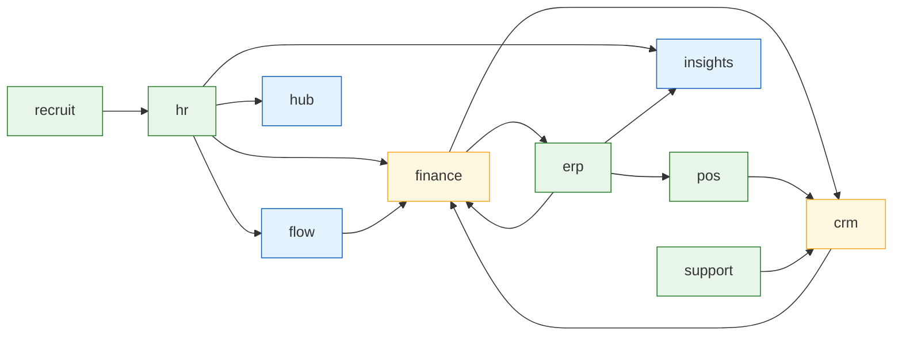

# 12. Coupling: the dependency graph and its acyclicity

Every dependency the 21 proposals would create, its direction, its owner, and a
committed script that asserts the graph is acyclic.

Run it:

```bash
node scripts/cross-app/check-acyclic.mjs
```

It exits non-zero on a cycle in the fact graph or on any proposal that cannot be
placed in that graph, so the assertion cannot rot as `connections.json` changes.

## What the script checks, and why it checks two graphs

Rule 2 of the coupling discipline says dependencies flow one way and a cycle
must be broken. Read naively at domain granularity, **this audit's proposals do
contain cycles**, and pretending otherwise would be the easy dishonesty here.
So the script reports two graphs:

| Graph  | Node                    | Contains cycles? | Is it the assertion?           |
| ------ | ----------------------- | ---------------- | ------------------------------ |
| Domain | a contract domain       | **yes, 3**       | no, reported for honesty       |
| Fact   | a `(domain, fact)` pair | **no**           | yes, this is the binding check |

The fact graph is the one that matters, because rule 2's real content is "no
connection may depend on the output of a connection that depends on it". That is
a statement about specific facts, not about whole domains. Two domains can
safely exchange different facts in opposite directions; what they must not do is
each compute their half from the other's answer.

A proposal with no `producerFact` / `consumerFact` label **fails** the check
rather than being skipped, so the graph cannot be quietly incomplete.

## The domain graph

14 directed edges over 10 domains (the `recruit` node is an app with no contract
domain, included because `REC->HR-01` is real).

| Edge              | Connections                           | Owner of the contract                                                   |
| ----------------- | ------------------------------------- | ----------------------------------------------------------------------- |
| `crm -> finance`  | CRM->FIN-01, CRM->FIN-02              | crm                                                                     |
| `erp -> finance`  | ERP->FIN-01, ERP->FIN-02, ERP->FIN-03 | erp                                                                     |
| `erp -> insights` | ERP->INS-01                           | erp for cost, insights for the metric                                   |
| `erp -> pos`      | ERP->POS-01                           | erp for the product, pos for the reference                              |
| `finance -> crm`  | FIN->CRM-01                           | finance                                                                 |
| `finance -> erp`  | FIN->ERP-01, FIN->ERP-02              | finance                                                                 |
| `flow -> finance` | FLOW->FIN-01                          | **hr** (the contract and rows are hr's, even though the data is Flow's) |
| `hr -> finance`   | HR->FIN-01                            | hr                                                                      |
| `hr -> flow`      | HR->FLOW-01, HR->FLOW-02              | hr                                                                      |
| `hr -> hub`       | HR->HUB-01                            | hr emits, hub decides what it means                                     |
| `hr -> insights`  | HR->INS-01                            | hr                                                                      |
| `pos -> crm`      | POS->CRM-01                           | pos                                                                     |
| `recruit -> hr`   | REC->HR-01                            | recruit (needs a contract first)                                        |
| `support -> crm`  | SUP->CRM-01                           | support                                                                 |

Plus two structural items that are not edges in this sense: `IDENTITY-01`
(hub as producer to every domain, which adds many edges into one already
universal node) and `HR->HR-01` (intra-domain).



Green nodes are pure producers, blue pure consumers, amber both.

## The three domain-level cycles, and why each is acceptable

The script reports:

```
crm -> finance -> crm
finance -> erp -> finance
crm -> finance -> erp -> pos -> crm
```

### 1. `crm <-> finance`

| Direction      | Fact                    | Connection                              |
| -------------- | ----------------------- | --------------------------------------- |
| crm to finance | who a customer is       | CRM->FIN-02 (and the deal, CRM->FIN-01) |
| finance to crm | what that customer owes | FIN->CRM-01                             |

**Acceptable, and the fact graph proves it.** `crm.customer_identity` feeds
`finance.invoice_customer_link`. `finance.invoice_balance` feeds
`crm.customer_credit_view`. The balance is computed from invoices, and invoices
need the identity, so there is a real ordering: **CRM->FIN-02 must ship before
FIN->CRM-01**, which its dossier states as a hard dependency.

What would make it a genuine cycle: if Finance computed the balance from
something CRM derived from the balance. It does not, and the fact graph would
catch it.

### 2. `finance <-> erp`

| Direction      | Fact                                                           | Connection               |
| -------------- | -------------------------------------------------------------- | ------------------------ |
| erp to finance | who a supplier is, what stock is worth, what has been received | ERP->FIN-01, -02, -03    |
| finance to erp | what has been billed and paid                                  | FIN->ERP-01, FIN->ERP-02 |

**Acceptable, and the tighter of the two.** Five connections on one pair of
nodes. The ordering is forced by data quality rather than by logic:
**ERP->FIN-01 must ship first**, because `supplier_id` on a bill is currently
fabricated from a slugified name
(`apps/finance/src/features/bills/Bills.tsx:59`). Filtering bills by supplier
before that is fixed returns correct results only by accident, which is why
`FIN->ERP-01`'s dossier calls itself worthless until then.

This pair is the one to watch. If a sixth connection is proposed on it, that is
the signal to consider whether ERP and Finance should exchange one
purpose-built aggregate instead of five point reads.

### 3. `crm -> finance -> erp -> pos -> crm`

A four-hop cycle that exists only because each pair individually is fine. No
single connection in it depends on any other's output: customer identity,
supplier payment history, product cost and order history are four unrelated
facts. **This is the clearest illustration of why the domain graph is the wrong
granularity for rule 2**: a cycle at this level tells you nothing about whether
any component is unsound.

## The fact graph

19 edges over 37 facts, acyclic. Every proposal is placed. The full listing is
printed by the script; the shape worth noting is that **no fact appears as both a
producer and a consumer fact**, which is the strongest available statement that
nothing here is circular.

One fact is reused across two connections: `hr.pay_rate` feeds both
`flow.project_labour_cost` and `insights.labour_cost_metric`. That is deliberate
and is the same endpoint serving both consumers, so the two cannot disagree
(`HR->INS-01`).

## Edge count per wave

Rule of thumb from the brief: if a wave adds more edges than proposals,
something is being over-connected.

| Wave | Proposals | New domain edges                                                         | Verdict                                                                   |
| ---- | --------- | ------------------------------------------------------------------------ | ------------------------------------------------------------------------- |
| 1    | 8         | 5 (`erp->finance`, `hr->finance`, `hr->flow`, `hr->hub`, `support->crm`) | fewer edges than proposals; three proposals share the `erp->finance` edge |
| 2    | 6         | 3 (`crm->finance`, `finance->erp`, `flow->finance` via hr)               | fine                                                                      |
| 3    | 5         | 3 (`erp->pos`, `erp->insights`, `hr->insights`)                          | fine                                                                      |
| 4    | 2         | many into hub, by design                                                 | identity is inherently a hub-in-the-middle shape                          |

Total: **14 new domain edges for 21 proposals.** The ratio holds because
Finance is the busiest consumer and several proposals reuse the same edge.

## Owners

Every edge has a named owner. An edge nobody owns rots, and this repo already
has an example: `flow.WorkType.hr_category_id` is a cross-domain field with no
owner on the consuming side, and nothing reads it (`02-entity-graph.md`).

| Domain       | Owns these crossings as producer                                                                                     |
| ------------ | -------------------------------------------------------------------------------------------------------------------- |
| **hr**       | employment status, pay rate, approved leave, payroll totals, and the `time_entry` contract that carries Flow's hours |
| **erp**      | supplier identity, product cost and stock, inventory valuation, purchase order receipt                               |
| **finance**  | invoice balance, bill payment history, bill settlement                                                               |
| **crm**      | customer identity, signed contracts                                                                                  |
| **pos**      | order history                                                                                                        |
| **support**  | ticket counts                                                                                                        |
| **recruit**  | candidate details, once contracted                                                                                   |
| **hub**      | the party concept (`IDENTITY-01`) and app entitlement                                                                |
| **insights** | the metric definitions built on foreign aggregates, never the source facts                                           |

Note the asymmetry in two cases, which is intentional and is the audit's main
design judgement:

- **`hr` owns the labour-cost aggregate even though Flow and Insights asked for
  it**, because the sensitive inputs are hr's. Ownership follows the data that
  must not leak, not the app that wants the answer.
- **`hr` owns the contract Flow's hours travel on** (`hr.time_entry.v1`), so a
  Flow change cannot break Finance without going through hr. That is a feature
  of the existing design, not something this audit introduced.

## The rules, checked

| Rule                                  | Status                                                                                                                                                                                                                                         |
| ------------------------------------- | ---------------------------------------------------------------------------------------------------------------------------------------------------------------------------------------------------------------------------------------------- |
| 1. Loosest shape that works           | 7 of 21 use shape 1, the loosest. Every tighter choice states why the looser failed; the sharpest cases are `HR->FLOW-01` (shape 1 would expose salaries) and `POS->CRM-01` (the contract cannot express the query).                           |
| 2. Dependencies flow one way          | Fact graph acyclic, asserted by script. Domain cycles reported and resolved above.                                                                                                                                                             |
| 3. Degrade, never break               | Every dossier states its degrade behaviour. Two make hiding a correctness requirement rather than a nicety (`ERP->FIN-02`, `HR->INS-01`).                                                                                                      |
| 4. Own your writes                    | No proposal has a frontend writing into a domain it does not own. `HR->FIN-01` reads payroll and writes Finance's own journal. `FIN->ERP-02` emits rather than writing ERP's purchase order status.                                            |
| 5. Two foreign reads per screen       | Binds on exactly one screen: the CRM customer page, wanted by `FIN->CRM-01`, `SUP->CRM-01` and `POS->CRM-01`. Resolved in `08-roadmap.md` by not putting all three in one wave and by naming the aggregate that would be required for a third. |
| 6. `packages/` is the last resort     | **No proposal touches `packages/**`.\*\* Shape 4 is empty: the closest candidate needs two apps, and the bar is three.                                                                                                                         |
| 7. No shared client state across apps | No proposal shares a store or a cache. Cross-app agreement is on the server; `07-plumbing.md` states the invalidation rule.                                                                                                                    |
| 8. Every coupling has a named owner   | Table above.                                                                                                                                                                                                                                   |
