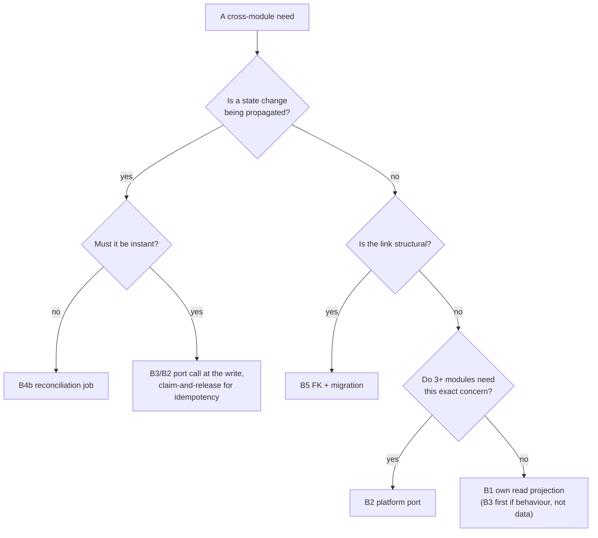

# 17. Backend plumbing blueprints

The backend half of `07-plumbing.md`: the shapes a cross-module connection can
take inside onion, **ordered loosest first**. Round one's frontend shapes and
these compose: a proposal picks one of each.

The backend's own written policy is `docs/sqlc-query-ownership.md` in onion.
This document defers to it rather than competing: no proposal imports another
module's internal infrastructure to reuse SQL; byte-identical queries in two
modules are legitimate when each owns its repository API, error mapping, cache
invalidation and transaction boundary; every duplicated query group discovered
here must be added to that register with a named owner.

## Shape B1. A read projection inside the consuming module

**The default answer.** The consuming module gets its own sqlc query over
tables it is entitled to read, its own repository method, registered in the
query-ownership register.

- **Where the code goes**: `<consumer>/sql/queries/<concern>.sql` plus the
  four layers. The query group goes into `docs/sqlc-query-ownership.md` with
  owner and disposition in the same format as issue #203's register.
- **Tenant predicate**: stated per query. Where the table chain has no direct
  `business_id` (Flow cycles, labels, notifications filter by
  `workspace_id`/`project_id`), scope through the owning aggregate id and say
  so; 230 existing queries already work this way (`13-backend-inventory.md`).
- **Index**: name it against `docs/tenant-index-matrix.md`. If no
  business-leading or owner-leading index serves the shape, add one in the same
  change; an aggregate without its index is an incomplete proposal.
- **Transaction boundary**: read-only, own connection.
- **Cache invalidation**: consumer-owned key via
  `internal/platform/cache/keys`; never assume the producing module's writes
  invalidate it.
- **Permission check**: the consuming handler enforces its own role rules; the
  query returns only rows the caller may see.
- **Producer off**: if the producing domain's tables are absent (tenant never
  enabled it), the projection returns an empty set; the screen renders its
  empty state. Never zero-fill.

Precedent: Insights reading `erp_products`, `finance_invoices`, `internal/modules/hr_shifts`
directly today (`backend_tables.csv`). ERP->INS-01's cheapest form is exactly
this shape.

## Shape B2. Fill or extend an internal/platform port

When three or more modules need one concern, or when the inputs are more
sensitive than the output (rates, salaries), the concern becomes a platform
package: contract-only directory, implementation owned by the data's module,
wired in `cmd/api/main.go`.

- **Where the code goes**: `internal/platform/<concern>/contract.go`
  (interface + value types only); implementation inside the owning module;
  wiring in `cmd/api/main.go` next to the three existing examples:
  - `SetLabourCostProvider(hrPayrollModule.LabourCostProvider())`
    (`cmd/api/main.go:466`)
  - `journalModule.SetPayrollAccountProvider(accountsModule.PayrollAccountProvider())`
    (`cmd/api/main.go:498`)
  - `hrPayrollModule.SetFinancePoster(journalModule.PayrollPoster())`
    (`cmd/api/main.go:499`)
- **Check before creating**: labourcost was declared-only for weeks before #743
  filled it. Prefer filling an existing dead or narrow port over adding a new
  package; prefer extending a port's result type over a second port for the
  same data.
- **Tenant predicate**: business id is a parameter on every port method, never
  derived inside the platform layer.
- **Transaction boundary**: the implementing module's; ports do not open
  transactions across modules.
- **Cache**: none at the port level; implementers may cache internally through
  the standard keys helpers.
- **Permission**: the implementing module enforces authorization; the port
  documents what may not leak (labourcost's contract comment is the model:
  "Implementations must not expose employee rates").
- **Failure mode**: noop/fallback implementations exist at the consumer for
  degraded tenancy (`internal/modules/workspaces/internal/application/service.go:127` noopLabourCostProvider);
  consumers must handle the fallback honestly rather than rendering zeros.

## Shape B3. An application-facing provider interface between two modules

One module calls another's behaviour, not its SQL. This is shape B2 with a
single consumer; use it before promoting anything to platform scope.

- Precedent: insights receives flow_insights' module as a narrow `FlowReader`
  interface at construction (`internal/modules/insights/module.go:39`, wired `cmd/api/main.go:464`);
  webhooks exposes itself to api_keys through hubdeveloper's provider port
  (`cmd/api/main.go:732`).
- Everything else matches B2: explicit interface, owner implements, main wires,
  tenant id passes through parameters.

## Shape B4. An event on wsbus, a job on jobs

For triggers and eventual consistency. The honest state of these substrates
after the events sweep:

- **wsbus** carries browser-realtime notifications only (topics `user:<id>`,
  `workspace:<id>`, `business:<id>`). It has fanout, backplane and presence;
  it has no persistence, no retry, no replay. Suitable for "tell the UI now",
  not for "guarantee this consequence".
- **jobs** runs six cron-style maintenance jobs on the worker with MySQL named
  locks. Suitable for periodic reconciliation, not instant reaction.
- **webhooks** have registration CRUD and no delivery engine at all
  (`backend_events.csv`). Nothing a tenant registers fires today.

So a round-two trigger proposal names one of:

1. **In-process port call at the state change** (the financejournal pattern):
   simplest, synchronous, fails loudly; requires both modules in one binary,
   which they are.
2. **A reconciliation job**: a jobs entry that periodically finds records where
   the consequence has not yet happened (terminations without revocation) and
   applies it idempotently. Survives crashes by design; latency is the cron
   interval. HR->HUB-01's recommended core.
3. **Filling webhook delivery**: a real project (worker-driven delivery with
   retries and signing). Justified only when tenants need outbound events;
   not required by any current proposal.

Whatever the choice: payload carries `business_id`; consumers re-check
authorization; delivery is idempotent (the payroll claim/release pattern is the
in-repo model: claim before acting, release on failure,
`internal/modules/hr_payroll/internal/application/service.go:377-409`); a dropped event must be recoverable by the
reconciliation read.

## Shape B5. A foreign key and a migration

Structural links: invoice customer_id, menu item product_id, support customer
reference, bill purchase order link. Rules carried over from round one's
frontend text, enforced server-side here:

- Nullable columns, additive migrations, no silent backfills (an email-match
  backfill asserts links the product cannot stand behind; run it as a reviewed,
  reported migration separately).
- Every write accepting a foreign id validates same-business ownership before
  insert/update; the validator change ships in the same PR as the column.
- Index every new FK with a business-leading composite where range scans will
  use it, added to `docs/tenant-index-matrix.md`.
- Atomicity stays within one module's transaction: the link row changes in the
  consumer's transaction; the referenced row is only validated, never mutated,
  there.

## Choosing

## The checklist every backend proposal answers

1. Which shape, and why the looser ones fail.
2. The query group added to `docs/sqlc-query-ownership.md` with its owner.
3. Tenant predicate per query, and the index serving it.
4. Transaction boundary: one connection for atomic writes.
5. Cache keys and who invalidates them.
6. Authorization location and rule.
7. Failure mode with the producing module disabled for a tenant: empty set or
   hidden section, never zeros, never a crash.
